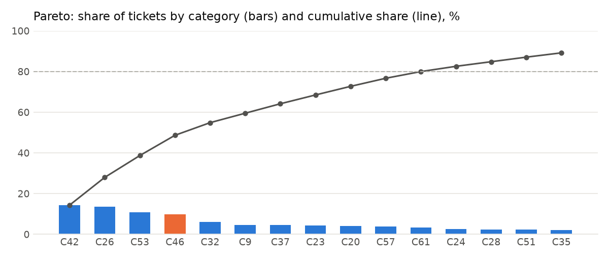
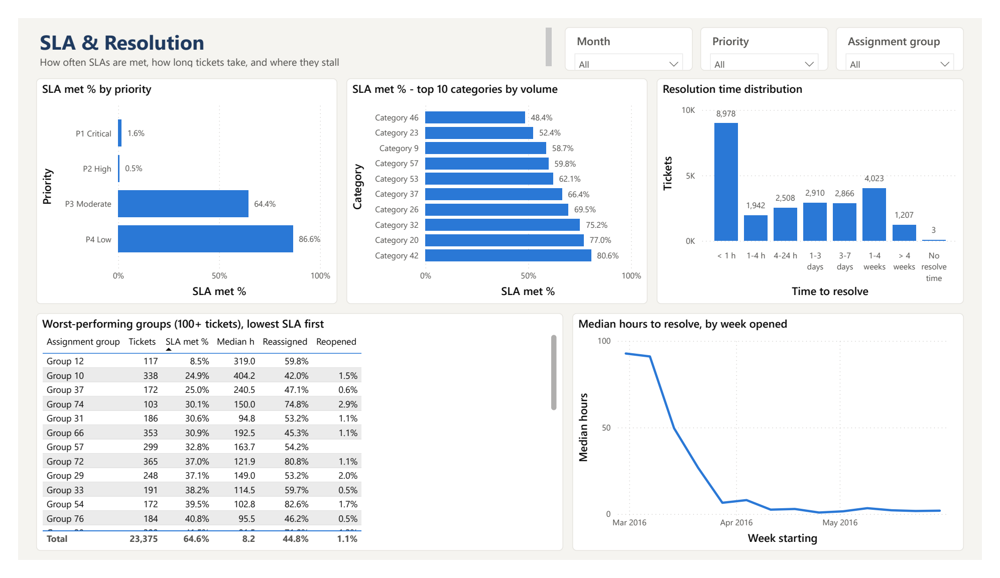
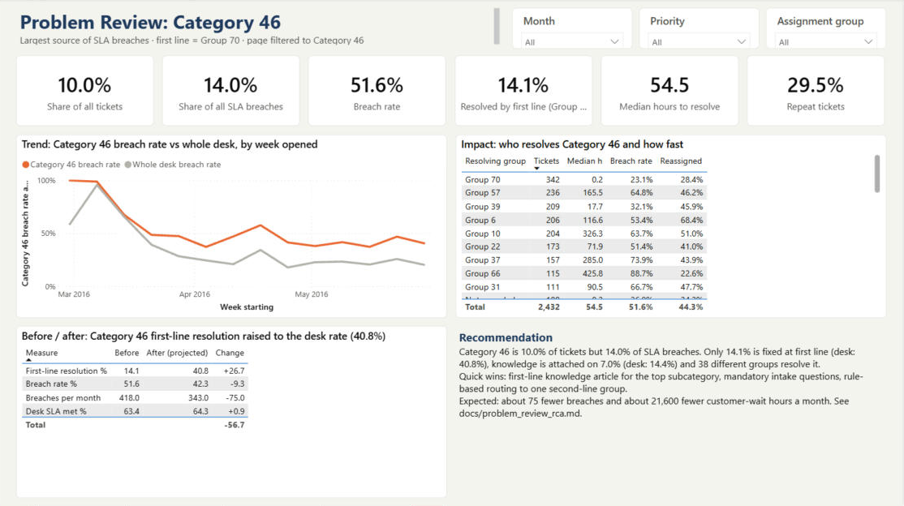
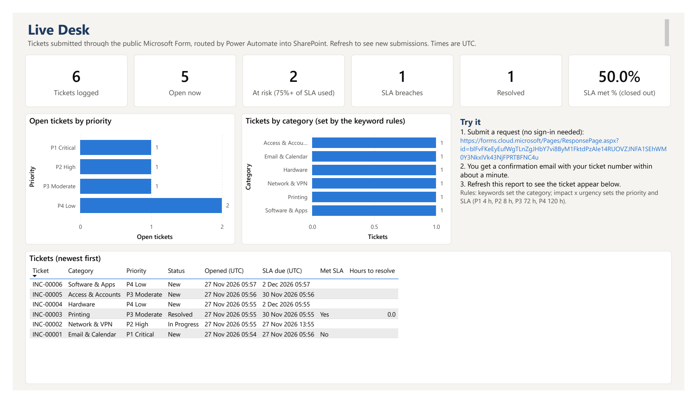

# IT Service Desk Performance & Problem Review

Analysis of 24,437 real ServiceNow incidents (Mar 2016 - May 2016): how the desk performed against SLA, which problem costs it the most, and what I'd change. It also includes a small working service desk built on Microsoft 365.

Try the live desk: [submit an IT request](https://forms.cloud.microsoft/Pages/ResponsePage.aspx?id=blFvFKeEyEufWgTLnZgJHbY7vi8ByM1FktdPzAle14RUOVZJNFA1SEhWM0Y3NkxIVk43NjFPRTBFNC4u). No account needed; you'll get a ticket number by email within a minute (it runs on a trial tenant until 2026-12-27). How it works: [power-automate/README.md](power-automate/README.md).

Dashboard as a PDF: [powerbi/ServiceDesk.pdf](powerbi/ServiceDesk.pdf).

## Data

UCI "Incident management process enriched event log": 141,712 events from a company's ServiceNow instance, which I collapsed to one row per incident. Category and team names are anonymised in the source. Cleaning steps are in [data_notes.md](docs/data_notes.md).

## Findings

1. 63.4% of tickets met SLA. March was the worst month at 39.9%; April and May were 76.7% and 77.5%. The median ticket took 14.9 hours, but the average was 165 because some tickets stay open for weeks.
2. Only 0.9% of the 656 P1/P2 tickets met SLA. That looks more like an SLA timer setup issue than real performance, so it should be checked before anyone acts on it.
3. 45.7% of tickets were reassigned at least once. Those took a median of 81.2 hours (vs 0.4 hours) and breached SLA 54.7% of the time (vs 21.5%).
4. The top 5 of 40 categories make up 54.9% of tickets.



## The problem I picked

Category 46 is 10.0% of tickets but 14.0% of SLA breaches, more than any other category. First line fixes only 14.1% of it (40.8% for everything else), knowledge articles are used on 7.0% of its tickets (14.4% elsewhere), and 38 different teams end up resolving it.

What I'd do: give it one owning team, write a first-line fix and intake questions for its most common subcategory, and route it by rule instead of by guesswork. If first-line resolution got to the desk average, that's roughly 75 fewer breaches a month, and the category's breach rate would drop from 51.6% to about 42.3%.

Full write-up: [problem_review_rca.md](docs/problem_review_rca.md). Handling guide for these tickets: [runbook_category_46.md](docs/runbook_category_46.md).

## Dashboard









## What's here

- [reports/service_desk_monthly_report.xlsx](reports/service_desk_monthly_report.xlsx): monthly Excel report, all formulas
- [powerbi/](powerbi/): Power BI project (`ServiceDesk.pbip`), `.pbix` and PDF
- [docs/](docs/): RCA, runbook, data notes
- [power-automate/](power-automate/): the live desk (form, SharePoint lists, 4 flows, exported packages, test log)

## Running it

```powershell
pip install pandas openpyxl matplotlib jsonschema pythonnet
python run_all.py
```

This rebuilds the clean data, the numbers, the Excel report, the docs and the Power BI project. If the project is open in Power BI Desktop it also refreshes it and checks every visual.
