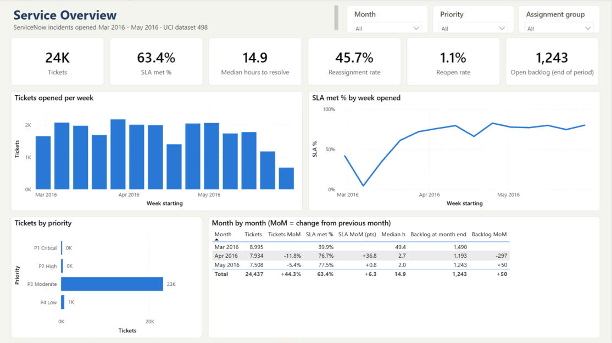
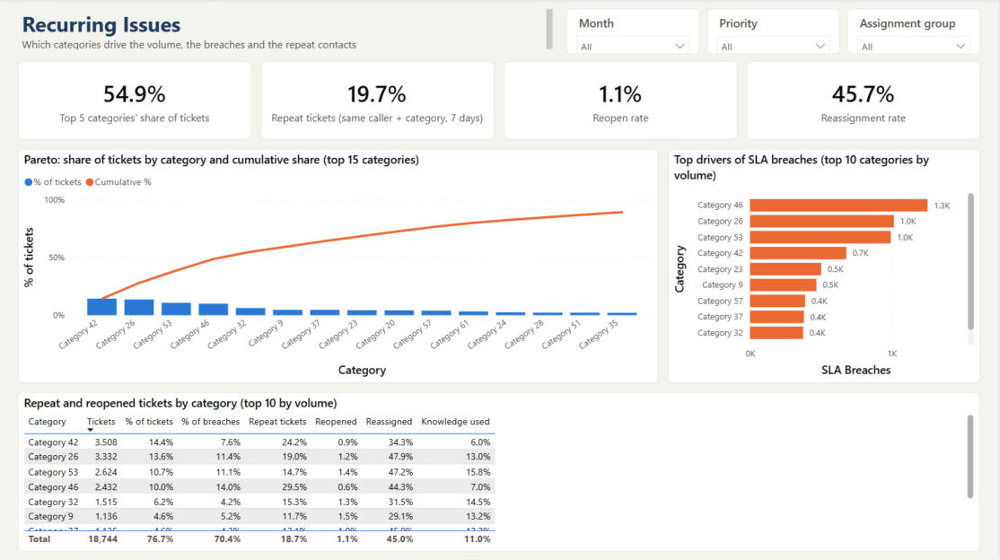

<!-- Generated by src/render_docs.py from docs/templates/README.md. Edit the template, not this file. -->
# IT Service Desk Performance & Problem Review

A sample of service-desk analysis on a **real ServiceNow incident log**: 24,437 incidents opened Mar 2016 - May 2016. It covers how the desk performed, which problem hurts it most, and what to do about it.

## Try it

- **Live service desk:** being set up. See [power-automate/](power-automate/).
- **Dashboard PDF:** [powerbi/ServiceDesk.pdf](powerbi/ServiceDesk.pdf). Screenshots are below.

## The question

How well is the service desk meeting its SLAs, and which recurring problem, if fixed, would improve service the most?

## The data

The "Incident management process enriched event log" from the UCI Machine Learning Repository: 141,712 events from a real company's ServiceNow instance, collapsed to one row per incident. Team and category names are anonymised in the source (e.g. "Category 46"). Every cleaning decision is listed in [docs/data_notes.md](docs/data_notes.md).

## Key findings

1. **About a third of tickets miss SLA.** 63.4% met SLA over the period. March was the worst month (39.9%). April and May recovered to 76.7% and 77.5%. The median ticket is resolved in 14.9 hours, but the average is 165 hours because a long tail of tickets stays open for weeks.
2. **Urgent tickets almost never meet SLA.** Only 0.9% of the 656 Critical and High tickets met SLA. This needs checking against how SLA timers are set up for those priorities before anyone acts on it.
3. **Passing tickets between teams is expensive.** 45.7% of tickets were reassigned at least once. Those tickets took a median of 81.2 hours, against 0.4 hours for tickets that stayed with the first team, and breached SLA 54.7% of the time against 21.5%.
4. **A few categories carry most of the load.** The top 5 of 40 categories account for 54.9% of tickets.


## The recurring problem and the recommendation

**Category 46 is 10.0% of tickets but 14.0% of all SLA breaches**, more than any other category. Only 14.1% of it is fixed by the first-line desk (the desk average is 40.8%). Knowledge articles are attached to 7.0% of its tickets (14.4% elsewhere), and 38 different teams end up resolving it.

**Recommendation:** give it one owning team, a first-line fix (knowledge article and intake questions) for its most common subcategory, and rule-based routing. If first-line resolution reaches the desk average, that's about **75 fewer SLA breaches a month** and the category's breach rate falls from 51.6% to about 42.3%.

- Full review: [docs/problem_review_rca.md](docs/problem_review_rca.md)
- How to handle these tickets: [docs/runbook_category_46.md](docs/runbook_category_46.md)

## Dashboard







## Files

| What | Where |
|---|---|
| Monthly Excel report (live formulas) | [reports/service_desk_monthly_report.xlsx](reports/service_desk_monthly_report.xlsx) |
| Power BI dashboard (open `ServiceDesk.pbip` in Power BI Desktop) | [powerbi/](powerbi/) |
| Problem review / root cause analysis | [docs/problem_review_rca.md](docs/problem_review_rca.md) |
| Runbook | [docs/runbook_category_46.md](docs/runbook_category_46.md) |
| Data notes | [docs/data_notes.md](docs/data_notes.md) |
| Live service desk (Power Automate) | [power-automate/](power-automate/) |

## Rebuild everything

```powershell
pip install pandas openpyxl matplotlib jsonschema pythonnet
python run_all.py
```

This cleans the data, recomputes every number, rebuilds the Excel report, re-renders these docs, regenerates the Power BI project and validates it. If Power BI Desktop has the project open, it also refreshes the model and tests every visual. The Power BI model reads the CSVs through one `DataFolder` parameter, which `run_all.py` points at this folder's `data/clean/`.
