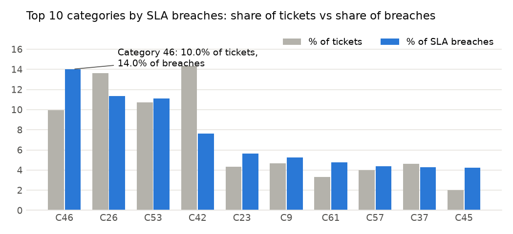
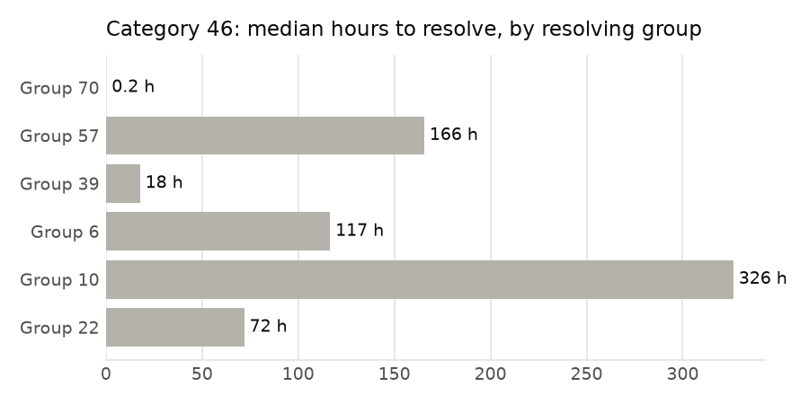
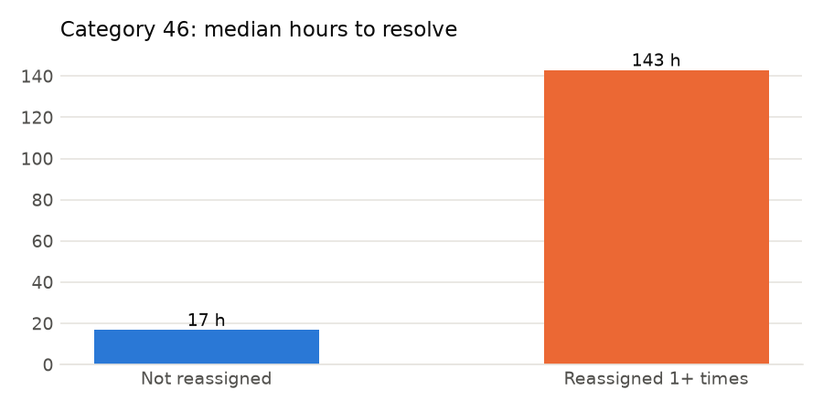

<!-- Generated by src/render_docs.py from docs/templates/problem_review_rca.md. Edit the template, not this file. -->
# Problem Review: Category 46 tickets miss SLA because they can't be resolved at first line

**Scope:** 24,437 incidents opened Mar 2016 - May 2016 (ServiceNow event log, UCI dataset 498). **Author:** Operations analysis. **Status:** for review.

## 1. Problem statement

**Category 46 is the largest single source of SLA breaches on the desk.** It makes up 10.0% of tickets (the #4 category by volume) but 14.0% of all SLA breaches. Half of its tickets breach (51.6%, against 35.0% for every other category). The median ticket takes 54.5 hours to resolve, against 7.4 hours elsewhere. Only 14.1% of these tickets are resolved by the first-line desk, compared with 40.8% for the rest of the workload.

## 2. Impact

| Measure | Category 46 | Rest of desk |
|---|---:|---:|
| Tickets per month | 811 | — |
| SLA breaches per month | 418 | — |
| Share of all SLA breaches | 14.0% | — |
| Breach rate | 51.6% | 35.0% |
| Median hours to resolve | 54.5 | 7.4 |
| Share of all customer wait hours | 18.5% | — |
| Wait hours above the desk's typical time, per month* | 243,800 | — |

\* The sum over these tickets of (hours to resolve − 7.4 h, the rest-of-desk median), counting only the hours above it. These are elapsed hours users spent waiting, not staff effort.

## 3. Evidence

Top five categories by SLA breaches:

| Category | Breaches | % of all breaches | Breach rate % |
|---|---:|---:|---:|
| Category 46 | 1,254 | 14.0 | 51.6 |
| Category 26 | 1,016 | 11.4 | 30.5 |
| Category 53 | 994 | 11.1 | 37.9 |
| Category 42 | 680 | 7.6 | 19.4 |
| Category 23 | 503 | 5.6 | 47.6 |

Who resolves Category 46, and how fast:

| Resolving group | Tickets | Median hours | Breach rate % |
|---|---:|---:|---:|
| Group 70 | 342 | 0.2 | 23.1 |
| Group 57 | 236 | 165.5 | 64.8 |
| Group 39 | 209 | 17.7 | 32.1 |
| Group 6 | 206 | 116.6 | 53.4 |
| Group 10 | 204 | 326.3 | 63.7 |
| Group 22 | 173 | 71.9 | 51.4 |

What sets Category 46 apart from the rest of the desk (all data-backed):

| Signal | Category 46 | Rest of desk | Reading |
|---|---:|---:|---|
| Resolved by first line (Group 70) | 14.1% | 40.8% | Most tickets have to go to a second-line team. |
| Knowledge article attached | 7.0% | 14.4% | There's little documented fix for first line to follow. |
| Went to "Awaiting User Info" at least once | 32.5% | 20.7% | Intake doesn't capture what the resolver needs. |
| Linked to a problem record | 4.6% | 1.0% | A problem record exists more often than elsewhere, a sign of known recurring faults, but most tickets are still worked one at a time. |
| Different resolving groups | 38 | — | There's no single owner. The top 5 groups resolve only 49.2%. |
| Repeat ticket (same caller, same category, within 7 days) | 29.5% | 18.6% | The first fix often doesn't stick, or the user comes back for the same thing. |
| Reassigned at least once | 44.3% | 45.8% | **About the same.** Reassignment isn't what sets it apart. |
| Reopened | 0.62% | 1.15% | Low, but repeat tickets suggest users open a new ticket rather than reopen the old one. |

When a Category 46 ticket *is* reassigned, its median time goes from 16.8 h to 142.8 h, and its breach rate goes from 42.6% to 62.9%.

Trend:

| Month | Tickets | Breach rate % | Reassigned % |
|---|---:|---:|---:|
| Mar 2016 | 908 | 66.1 | 46.3 |
| Apr 2016 | 787 | 45.6 | 44.2 |
| May 2016 | 737 | 40.0 | 41.9 |

The breach rate improved after March, along with the whole desk (see the data notes on March), but in May 2016 its breach rate was still 40.0%, against 22.5% for the desk as a whole.

## 4. Root cause analysis (5 whys)

| Why? | Answer | Basis |
|---|---|---|
| 1. Why does Category 46 drive the most breaches? | Its tickets take far longer to resolve (median 54.5 h against 7.4 h). | **Data** |
| 2. Why do they take longer? | Only 14.1% are fixed at first line. The rest wait in a second-line queue, where the median is 86.2 h. | **Data** |
| 3. Why can't first line fix them? | There's no documented fix for first line to use: knowledge is attached on 7.0% of tickets, half the desk rate. Intake also misses information, so a third of tickets stall in "Awaiting User Info". | **Data** (rates). The claim that no first-line procedure exists is an **assumption**, to be confirmed with the desk lead. |
| 4. Why is there no documented fix or clear route? | Ownership is spread over 38 resolver groups, with a 17.7 h median in the fastest (Group 39) and 326.3 h in the slowest (Group 10). Nobody owns the category end to end. | **Data** (spread). That this causes the missing knowledge is an **assumption**. |
| 5. Why has nobody owned it? | The faults recur (problem records are linked 4.6% of the time against 1.0% elsewhere), but the other tickets are still handled one at a time instead of being fixed at the source. | **Data** (link rates). That problem management isn't driving a permanent fix for this category is an **assumption**. |

**Root cause (working hypothesis):** Category 46 has no owning team and no first-line resolution path, so tickets that first line could solve are queued in slow second-line teams.

**What the data can't tell us** (because labels are anonymised and there's no free text): what the category actually is, or whether its fixes need access rights that first line doesn't have. Confirm both with the desk before committing to the long-term fixes.

## 5. Recommended fixes

**Quick wins (2–4 weeks)**
1. Write a first-line knowledge article for the top subcategory (Subcategory 223, 28.0% of the category) and attach it in the ticket template.
2. Add mandatory intake questions for Category 46 (see the runbook) to cut "Awaiting User Info" stalls.
3. Route by rule: send Category 46 tickets that first line can't solve to the fastest-performing group (Group 39) instead of a free choice of 38 groups.

**Long-term (1–2 quarters)**
1. Name one owning group for Category 46, with a monthly review of its SLA and its first-line resolution rate.
2. Open a problem record for the top recurring subcategories and fix the underlying fault, not each ticket.
3. Give first line the access or tools it needs for the common fixes (confirm what's needed first).

## 6. Expected impact

| Scenario | Change | Customer wait hours saved per month | Breaches avoided per month | Result |
|---|---|---:|---:|---|
| **A (primary)** | First-line resolution of Category 46 goes from 14.1% to the desk rate of 40.8% (≈217 more tickets a month fixed at first line) | ≈21,600 | ≈75 | Category breach rate 51.6% → 42.3%. Desk SLA 63.4% → 64.3% |
| B | Halve the number of reassigned Category 46 tickets (≈359 a month today) | ≈22,600 | ≈36 | Category breach rate → 47.1% |

The scenarios overlap, so don't add them together. **How the estimates are built:** each ticket that moves is assumed to take the median time and breach rate of the group it moves to. That's a correlation, not a controlled test, because first line may already keep the easier tickets. Treat the figures as an upper bound and check them against the measures below.

## 7. How success will be measured

The targets apply scenario A's relative improvement to the latest month (May 2016).

| Measure | Whole window | May 2016 (baseline) | Target | Source |
|---|---:|---:|---:|---|
| Category 46 first-line resolution % | 14.1% | 11.8% | ≥ 40.8% | Power BI, Problem Review page |
| Category 46 breach rate | 51.6% | 40.0% | ≤ 32.8% | Power BI / Excel Top 10 |
| Share of Category 46 tickets that went to "Awaiting User Info" | 32.5% | — | ≤ 20.7% (desk rate) | Event log |
| Knowledge attached on Category 46 tickets | 7.0% | — | ≥ 14.4% (desk rate) | Event log |
| Desk SLA met % | 63.4% | 77.5% | ≥ 78.4% | Excel Summary |

Review monthly for three months. If first-line resolution rises but the breach rate doesn't fall, the bottleneck is second line, so move to the long-term fixes.
