# Live service desk (Microsoft Forms + SharePoint + Power Automate)

A small working IT service desk on Microsoft 365. Anyone can submit a request without an account and get a ticket number by email.

**Try it:** [Submit an IT request](https://forms.cloud.microsoft/Pages/ResponsePage.aspx?id=blFvFKeEyEufWgTLnZgJHbY7vi8ByM1FktdPzAle14RUOVZJNFA1SEhWM0Y3NkxIVk43NjFPRTBFNC4u). You'll get a confirmation email within a minute.

> The desk runs on a Microsoft 365 Business Basic **trial tenant that expires on 27 Dec 2026**. After that the form and flows stop. The screenshots and the exported flow packages below still show how it worked, and the packages can be imported into any tenant.

## How it works

```
Microsoft Form ──► Flow 1 "New ticket" ──► SharePoint list "IT Tickets" ◄── Power BI "Live Desk" page
  (public)           rules lists:                │
                     keywords → category          ├─► Flow 2 "SLA watch"   every 15 min: warn at 75%, escalate at breach
                     impact × urgency → priority  ├─► Flow 3 "Resolution"  Status = Resolved → record time + SLA, email requester
                     priority → SLA hours         └─► Flow 4 "Daily digest" 8:00 → open tickets, backlog by priority, at risk
                     → confirmation email (+ lead alert for P1/P2)
```

| Rule | Source |
|---|---|
| Category = the first keyword rule that matches the **service the requester picked**, otherwise the description, otherwise "Other" | `rules/keywords.csv` → SharePoint list *Desk Rules - Keywords* |
| Impact = High if the description mentions e.g. "everyone", "outage" or "entire"; Medium for "team", "several", "colleagues"; otherwise Low | `rules/impact_keywords.csv` → *Desk Rules - Impact* |
| Priority and SLA = impact × urgency (the same matrix as the historical ServiceNow data). P1 4 h, P2 8 h, P3 72 h, P4 120 h. Warn at 75% of the time. | `rules/priority_matrix.csv` → *Desk Rules - Priority* |

The rules live in SharePoint lists, so the desk lead can change them without editing a flow.

## End-to-end test (27 Nov 2026)

| # | Submission | Urgency | Result | Emails |
|---|---|---|---|---|
| 1 | Outlook outage for **everyone** in the office | High | INC-00001 · Email & Calendar · **P1 Critical** · 4 h SLA | Confirmation + HIGH PRIORITY lead alert |
| 2 | VPN drops for the **entire** finance team | Medium | INC-00002 · Network & VPN · **P2 High** · 8 h | Confirmation + lead alert |
| 3 | 3rd-floor printer offline for **several** colleagues | Medium | INC-00003 · Printing · **P3 Moderate** · 72 h | Confirmation |
| 4 | Please install Visio on my laptop | Low | INC-00004 · *Hardware* (bug) · **P4 Low** · 120 h | Confirmation |
| 4b | Same request, re-run after the fix | Low | INC-00006 · **Software & Apps** · P4 Low | Confirmation |
| 5 | Locked out after a password reset | High | INC-00005 · Access & Accounts · **P3 Moderate** · 72 h | Confirmation |

Then, with `scripts/exercise_lifecycle.py`:
- **Resolution:** INC-00003 was set to Resolved with notes. Flow 3 recorded the resolve time and "Met SLA: Yes" and emailed the requester.
- **SLA watch** (*simulated time*): INC-00002's warning time and INC-00001's due time were moved to "now" so the flows fired without waiting hours. The changes are labelled "TEST:" on each ticket. INC-00002 got the 75% warning to its assignee, and INC-00001 was escalated to the lead and marked "Met SLA: No".
- **Daily digest:** run on demand. It showed 5 open tickets, backlog by priority, and 2 at risk.

**Bugs found by the test and fixed:**
1. Category came from the description before the service the requester picked ("laptop" beat "install"). The service now wins.
2. The digest used `lessOrEqual` (the correct function is `lessOrEquals`), so its first run failed.
3. The digest's at-risk count left out tickets that had already breached.

## Screenshots

| | |
|---|---|
| 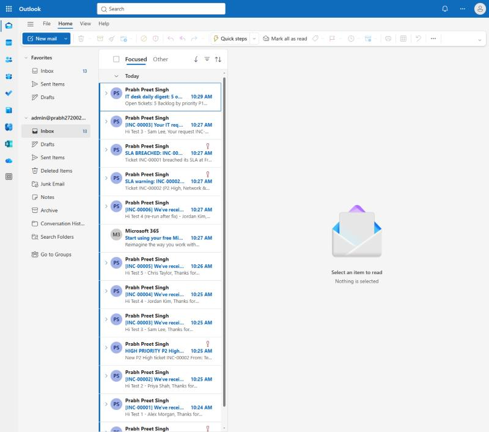 | 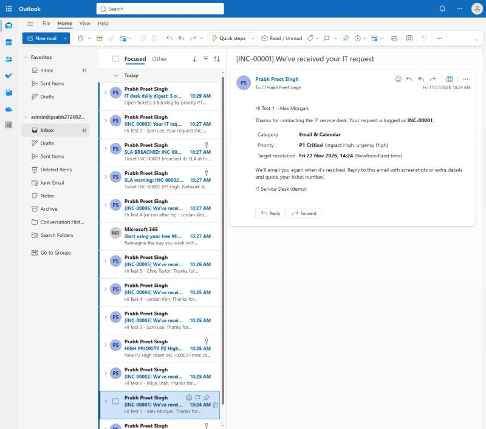 |
| 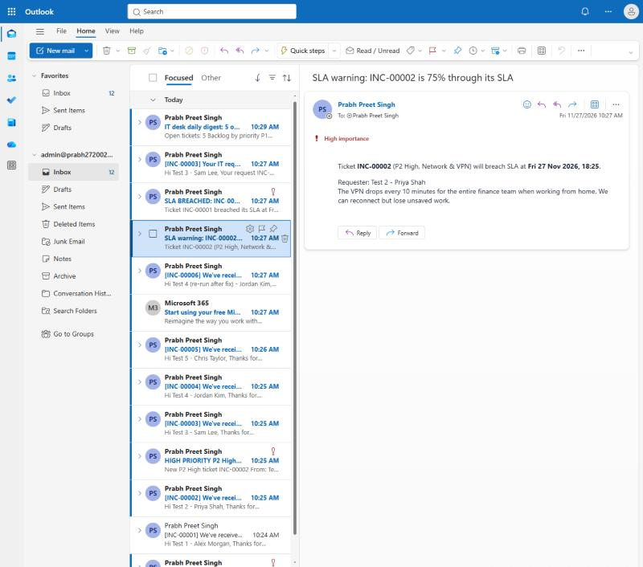 | 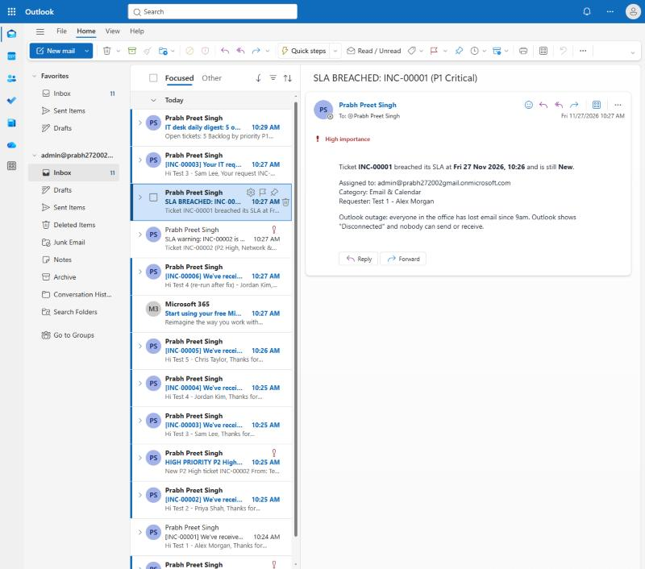 |
| 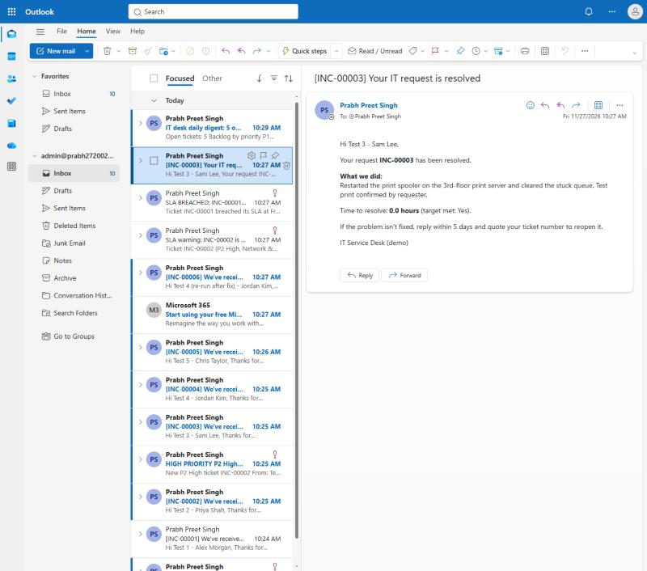 | 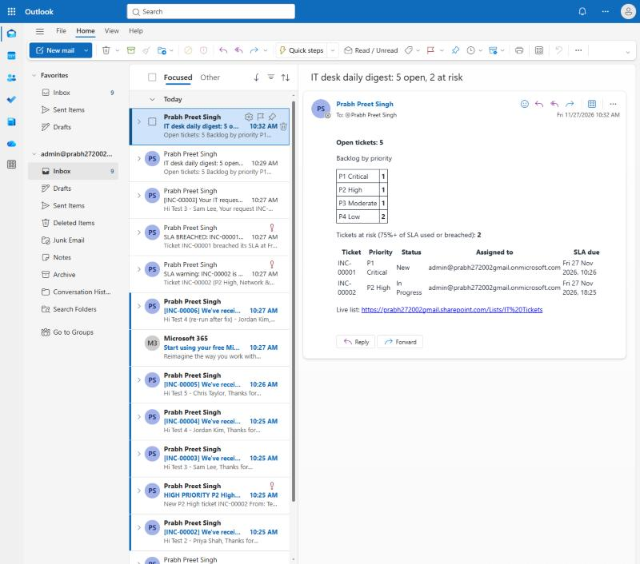 |
| 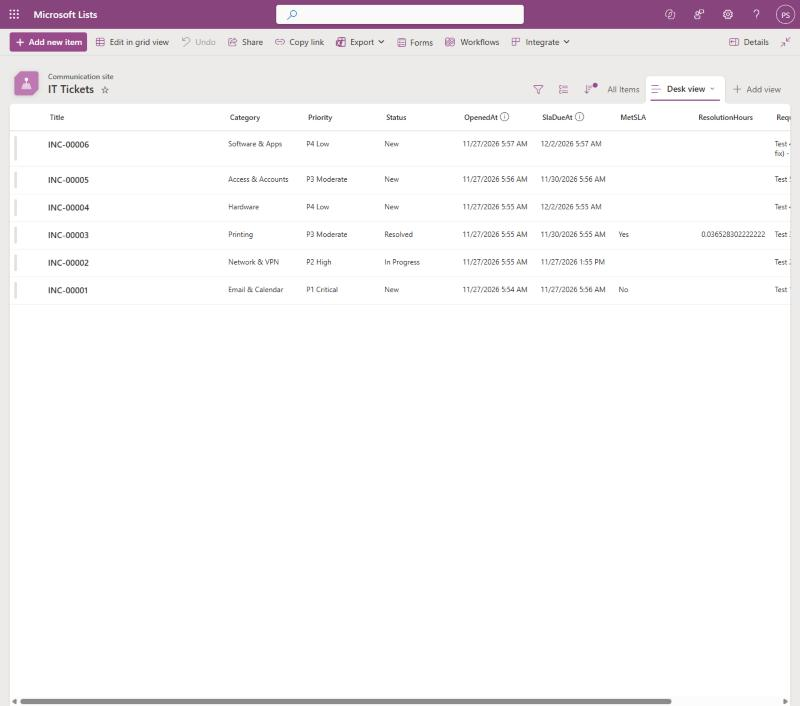 | 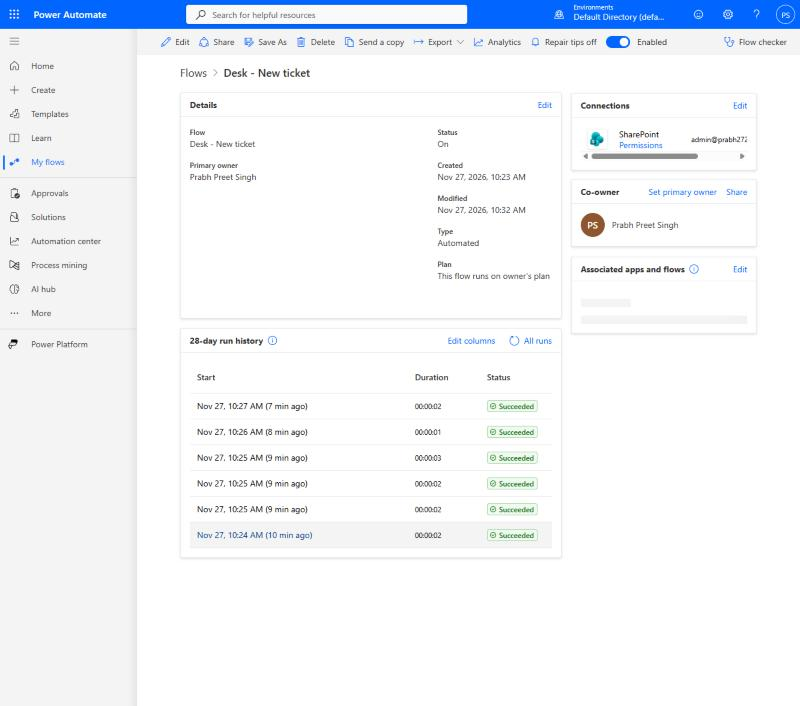 |
| 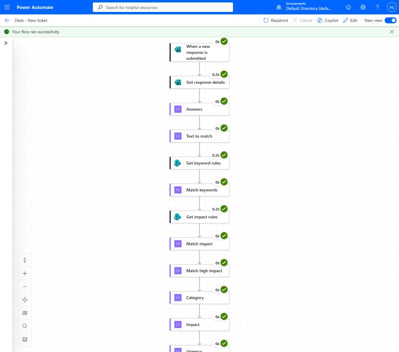 | 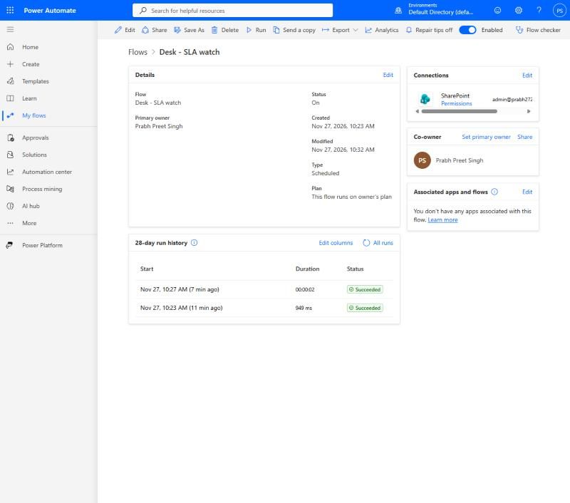 |
| 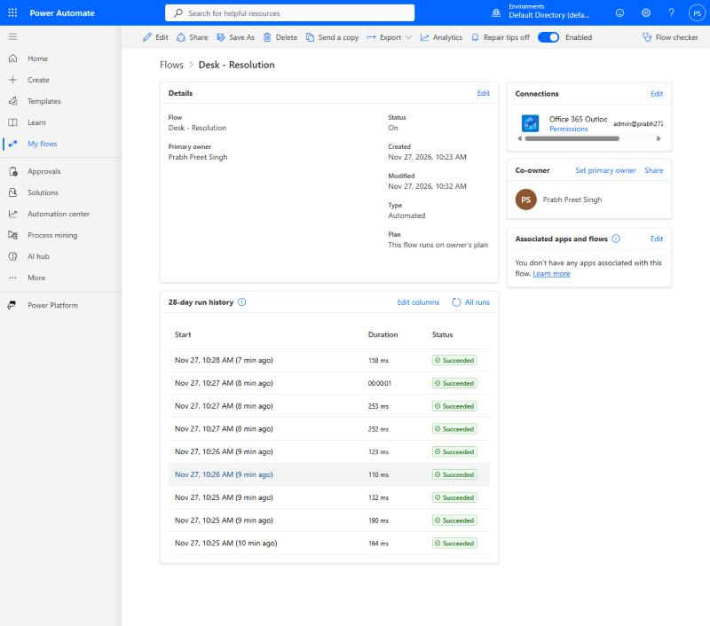 | 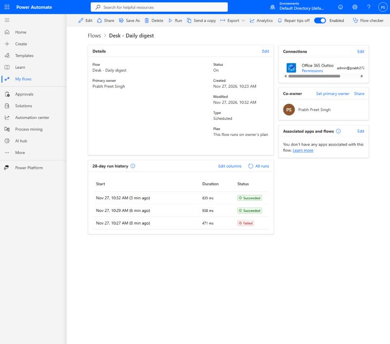 |

## Files

| Path | What |
|---|---|
| `packages/*.zip` | The 4 flows exported as Power Automate packages (My flows → Import → *Import package (Legacy)*) |
| `flows/*.json` | Each flow's workflow definition, so the logic can be reviewed in git |
| `rules/*.csv` | The routing rules loaded into SharePoint |
| `scripts/provision_sharepoint.py` | Creates the 4 SharePoint lists and loads the rules (Microsoft Graph) |
| `scripts/flow_definitions.py`, `scripts/deploy_flows.py` | Build the flows from `desk_config.json` and create or update them through the Power Automate API |
| `scripts/create_list_view.py` | Adds the compact "Desk view" to the ticket list |
| `scripts/exercise_lifecycle.py`, `scripts/flow_runs.py` | The lifecycle test above, and a run and ticket report |
| `scripts/export_packages.py` | Regenerates `packages/` |
| `desk_config.json` | Tenant, site, list, form and question IDs (no secrets; sign-in tokens are cached outside the repo) |

## Deploy it in another tenant (about 15 minutes)

You need a Microsoft 365 work account with SharePoint, Forms, Outlook and Power Automate (Business Basic is enough).

1. In `desk_config.json`, set `tenant_id`, `account`, `site_url`, `lead_email` and `default_assignee_email`.
2. Run `pip install msal requests`, then `python scripts/provision_sharepoint.py`. Sign in with the device code when asked. This creates the lists and loads the rules.
3. Create a Microsoft Form with the 5 questions (name, email, service, description, urgency as High / Medium / Low), and set **Collect responses → Anyone can respond**. Put its ID and question IDs in `desk_config.json`.
4. In Power Automate, go to **Connections** and create **SharePoint**, **Microsoft Forms** and **Office 365 Outlook** connections.
5. Run `python scripts/deploy_flows.py`. This creates the 4 flows, switched on.
6. Submit a test request, then check the result with `python scripts/flow_runs.py`.
